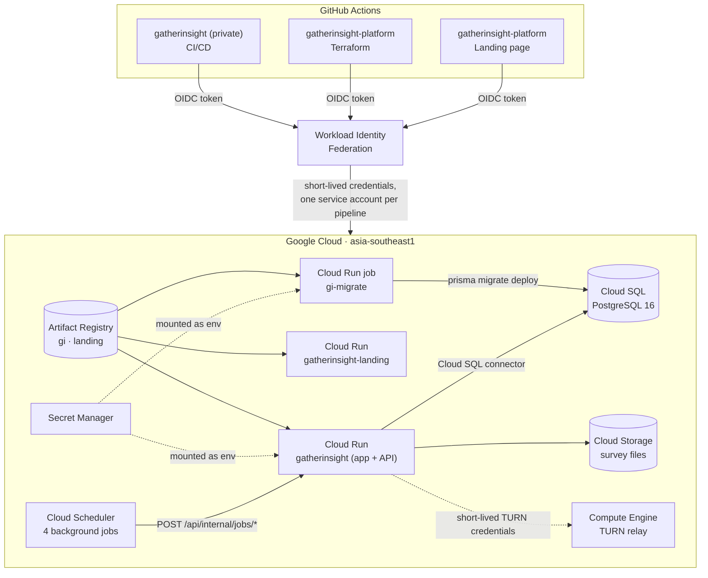
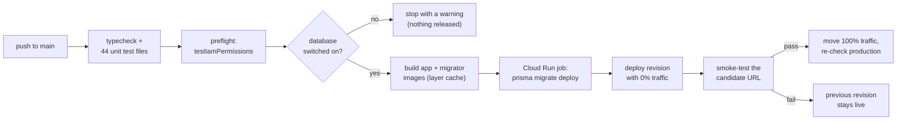

# GatherInsight Platform

[](https://github.com/baldan555/gatherinsight-platform/actions/workflows/terraform.yml)
[](https://github.com/baldan555/gatherinsight-platform/actions/workflows/landing.yml)

Infrastructure as code, CI/CD and the public landing page of **GatherInsight**, a survey research platform
(Next.js web app, PostgreSQL, Android app for field surveyors) running on Google Cloud.

**Live:** [gatherinsight.baldanproject.my.id](https://gatherinsight.baldanproject.my.id/) ·
**Author:** N.I.S. Baldanullah ([portfolio](https://portofolio.baldanproject.my.id/))

| | |
|---|---|
| `infra/` | Terraform for the whole production project: Cloud Run, Cloud SQL, Cloud Storage, Artifact Registry, Secret Manager, Cloud Scheduler, a Compute Engine TURN relay, IAM and Workload Identity Federation |
| `.github/workflows/terraform.yml` | Plan on pull requests, guarded apply on `main`, weekly drift check |
| `.github/workflows/landing.yml` | Build, test and deploy the landing page |
| `app-pipeline/` | Read-only mirror of the application's CI/CD (the app repository is private) |
| `landing/` | The landing page itself (static HTML + nginx) |
| `scripts/` | `power.sh` (switch the demo environment off and on), `deploy-landing.sh` (manual fallback) |

## Architecture



People reach the app through `app.gatherinsight.baldanproject.my.id`, surveyors through the Android app (same API),
respondents through public survey links, and phone interviews relay audio through the TURN server when browsers
cannot connect directly.

## Pipelines

### Application release (private repository, mirrored in `app-pipeline/`)



- Every push and pull request runs the typecheck and the unit tests.
- A new revision is tested on its own tagged URL before any user can reach it: a broken build never takes traffic.
- The preflight asks Google Cloud whether the deployer may perform every step, so a missing permission fails
  loudly even on days the release itself is skipped.

### Infrastructure (`terraform.yml`)

- **Pull request:** `fmt`, `validate`, and a plan with a **read-only** identity, posted as a comment.
- **Push to `main`:** plan, then **refuse any plan that deletes or replaces a resource**, then apply.
  Destructive changes have to be applied deliberately from a workstation.
- **Every Monday:** plan only. The run fails if the live project has drifted from the code.

### Landing page (`landing.yml`)

Build the image, serve it in the runner and compare each page byte for byte with the repository, push, roll out,
then confirm that both the Cloud Run URL and the custom domain serve exactly the new commit.

## Security

- **No service account keys.** GitHub Actions exchanges its OIDC token for short-lived credentials. The identity
  provider only accepts tokens from this GitHub account and these two repositories, matched on immutable numeric
  ids, and each service account can only be used from the branch or event listed below.
- **One identity per job, least privilege:**

  | Service account | Used by | Allowed to |
  |---|---|---|
  | `gh-deploy-app` | app repo, pushes to `main` | push to the `gi` registry, update the app service and the migration job, start them as `gi-run`; read-only Cloud Run and Cloud SQL |
  | `gh-deploy-landing` | this repo, pushes to `main` | push to the `landing` registry, update the landing service, start it as `gi-landing` |
  | `gh-terraform` | this repo, pushes to `main` | apply this configuration |
  | `gh-terraform-plan` | this repo, pull requests | read only (viewer, IAM reviewer, state reader) |
  | `gi-run` | the app at runtime | Cloud SQL client, its own secrets, objects in the files bucket |
  | `gi-turn` | TURN relay VM | read one secret |
  | `gi-landing` | landing page at runtime | nothing |

- **Secrets stay in Secret Manager.** Terraform manages which secrets exist and who may read them, never their
  values. The only value Terraform reads is the scheduler's bearer token. It is read at plan time, marked sensitive
  (logs show `(sensitive value)`), and kept only in the private, versioned state bucket.
- **Pull requests from forks get no cloud credentials.** The plan job does not run for them.
- **Network:** Cloud SQL has no authorised networks (only the IAM-checked connector can reach it). The relay VM opens
  only its TURN ports, allows SSH only through Identity-Aware Proxy, and denies SSH/RDP from the internet.

## Cost control

This is a demo environment, so it costs close to nothing while idle:

- Both Cloud Run services scale to zero (`min_instance_count = 0`).
- `scripts/power.sh off` pauses the scheduler jobs and stops Cloud SQL; `on` starts them again and checks the app.
  Terraform ignores the on/off state on purpose, and the release pipeline skips cleanly while the database is off.
- Artifact Registry cleanup policies keep recent images only. On the landing repository they are active; on the
  app repository they run as a dry run until the results have been reviewed.

## Adopting a running system

Everything here existed before it was written in Terraform. `infra/imports.tf` adopted 47 live resources
(services, database, buckets, secrets, scheduler jobs, the VM and its firewall, IAM bindings) with import blocks.
The configuration was then tuned until `terraform plan` showed only the changes intended, so nothing was recreated.
The deliberate changes in that first apply were:

- the landing page moved off the default compute service account (project Editor) onto a zero-permission identity;
- cleanup policies were added to the image registry;
- the CI identities and Workload Identity Federation were created.

Design choices that keep the code and the live system from fighting each other:

- **Terraform owns configuration, pipelines own images.** Each Cloud Run service ignores `image` (and the app ignores
  `traffic`), so a release never shows up as drift.
- **Operational toggles are ignored.** That covers the database activation policy and the scheduler `paused` flag.
- **Databases and users are not managed here.** Reading them needs a running instance, and user passwords do not
  belong in state.
- **Critical resources have `prevent_destroy`**, on top of the provider's deletion protection.

## Working on it locally

```bash
cd infra
export GOOGLE_OAUTH_ACCESS_TOKEN="$(gcloud auth print-access-token)"
terraform init
terraform plan
```
